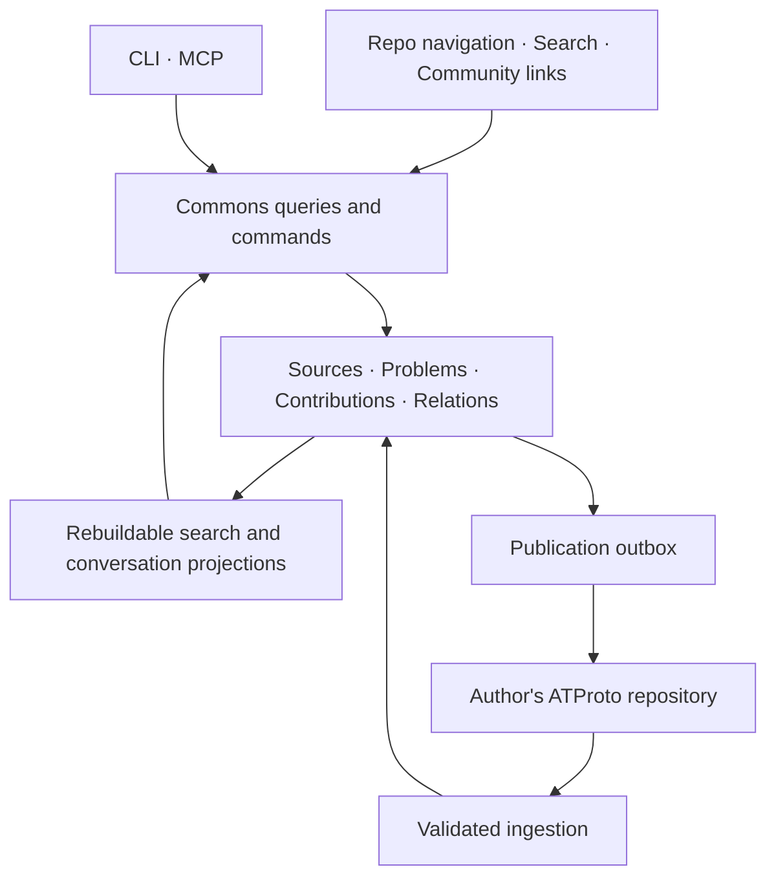

# Multi-entry Commons — shared experience across interfaces

31 October 2026 · Implementation specification

## Direction and status

Achim explicitly corrected the single-door funnel: repository navigation, search, agent CLI/MCP and community links are different entrances. The architecture must bring their contributions and context together, including an ATProto participation path. He authorized this specification and the next Claude build plan. The implementation choices below are proposed defaults, not claims of shipped capabilities or acceptance of every earlier architecture proposal.

The product is a shared space of attributable experiences around problems, accessible through multiple tools. A problem page is one projection. An agent answer is another. Neither owns the underlying conversation.

This extends the first local slice in `docs/build/CLAUDE-ORCA-BUILD.md`; its blanket deferral of ATProto is superseded for the next build only. Local-first operation, no automatic public posting, optional Knowledge Lab and preservation of provenance remain. The older `PROPOSED-SHARED-MEMORY.md` remains historical design context where it differs. Observatory project memory is separate from community problem memory.

## Baseline actually inspected

- Main: `58b99426d39921975411ab7a1541c0571c863e35`.
- Commons implementation: PR #8, `e24838fe25a7aa1e4c9648f8dee03ce159883b28`; not merged when inspected.
- Existing `src/commons/contracts.ts`: SourceRef, ImportedProblem, CommonsReader, browser Draft, idempotent SubmitContributionCommand and ReviewCommand.
- Existing `server/commons/routes.ts`: authenticated local contribution/review/room routes; trusted corpus import at startup.
- Existing `server/mcp/register-tools.ts`: shared registration and application-service boundary; its ToolServices type currently selects problems/contributions/curation/orchestration, not the complete Commons reader/command surface.
- BUILD-STATUS and DEMO report 149 tests and a local two-session loop. Those tests were not rerun while writing this plan. Final batch-4 fixes still require bounded review.
- Hosted knowledge resolves to main above, complete 13/13 sources, but has invalid_status and invalid_relation diagnostics for the timetable. PR #4 repairs them; do not mistake complete=true for diagnostic-free.
- Hosted activity snapshot is dated 13:28:50Z, older than PR #8's latest work. Use live PR heads for implementation.

## Experiences to support

| Entrance | Person's action | Shared result |
| --- | --- | --- |
| Repository navigator | Browse repository → file/thread → linked problems | Same problem IDs, sources and community contributions |
| Search | Ask “My Mac cannot see my frame” | Applicable accounts and qualified near-matches, with inspectable evidence |
| Agent CLI/MCP | Find, inspect, retrieve context, prepare a contribution | Structured records with provenance, omissions and stable links |
| Community link | Open a problem, contribution, reply or correction directly | Preserve conversation position and author; allow response without repeating search |
| ATProto-capable client | Publish an owned experience or reply; read another person's record | Ingest into the same discovery projections with external identity and revision intact |

“Google-style search” means a search interaction. This build does not promise Google indexing, browser search integration or a Google API dependency.

## Architecture and ownership

- Source snapshots own deliberately captured evidence. Original author, importer and record writer remain separate.
- Existing application services own local writes, command deduplication, permissions and event history. All adapters call these services; no second domain engine in MCP or UI.
- ATProto repositories own their published records. Our local copy is an attributed observation/cache, not authority to rewrite another author's content.
- The app view owns indexing, discovery and a declared local moderation policy. It is replaceable and rebuildable from available inputs; this does not imply complete recovery of deleted external history.
- Search indexes and optional LightRAG results are derived. No live model is necessary for the acceptance journey.
- Observatory owns development context, not the community's social records or moderation.

## Identity and record contract

Extend existing types compatibly; migrate persisted data without changing imported IDs. Freeze the exact TypeScript runtime-validated schemas in the first build commit.

| Record | Minimum fields / semantics |
| --- | --- |
| Problem | Existing stable ID and room mapping; title, conditions, symptoms, aliases, source refs, provenance; canonical app URL |
| SourceRef | Preserve existing snapshot/object/permalink/author/time/digest/locator/availability fields; add typed source kind and repository/path association where supported |
| Contribution | Stable contribution ID; problem reference; kind: question, observation, attempt, outcome, correction; selected text; conditions; source refs; actor; assistance declaration; createdAt; observedAt; revision; origin |
| Reply/correction | Contribution plus parent and optional supersedes/contradicts reference; preserve both voices; do not mutate the target author's record |
| Relation assertion | Stable ID; typed endpoints; kind; proposer; evidence refs; local review state and reviewer; machine-origin disclosure |
| External mapping | Local ID ↔ AT URI; observed CID/revision; DID; PDS endpoint resolution metadata; retrieval time; availability; publication receipt |
| Command receipt | Actor + command ID + normalized payload hash; resulting IDs/revisions; replay indicator; publication state separate from local save |

Use discriminated references: local `{kind: local, id, revision?}`, source `{kind: source, sourceRef}`, AT `{kind: atproto, uri, cid?}`. A local ID is not an AT URI. Pin CID when referring to an exact AT record version; distinguish a reference to a logical record from a versioned assertion. Preserve source revision separately from import time.

For the pilot, imported problem IDs stay stable. Publish references to their canonical app URL plus source repository/object/revision identifiers; do not claim those problems were authored on ATProto. Cross-app problem equivalence is unresolved: ingest an unfamiliar problem reference as unresolved, never silently merge by title similarity.

DID identifies the publishing account, not proof of a human or factual correctness. Handle is display metadata. Derive publisher from authenticated session or resolved repository identity, never a body-supplied author string. `preparedBy` and declared assistance describe preparation, not verified detection of AI use.

## One service contract, multiple adapters

Suggested operation names; coordinator may align naming with existing conventions, preserving semantics:

| Operation | Purpose |
| --- | --- |
| search(query, filters, cursor) | Search source-derived problems AND eligible new contributions; return common IDs and match reasons |
| browseRepository(repository, path?, object?, cursor) | Navigate the bounded corpus and related problem records; disclose coverage |
| getProblem(id), getContribution(id), getThread(id) | Stable deep-linked views of evidence, voices, replies, corrections and unknowns |
| getContext(target, budget) | Deterministic agent-readable packet with revisions, source links, omission list and freshness |
| prepareContribution(input) | Validate selected content and return exact preview/destination; no external write |
| submitContribution(command) | Save local shared contribution once using existing transactional commands |
| preparePublication(id, destination) | Produce exact AT payload preview and a content-bound publication intent |
| publishContribution(intent) | Authenticated explicit publication; queue durable outbox, return pending or confirmed receipt |
| syncAuthor(did), resolveExternal(uri) | Bounded validated ingestion; discover remote contributions without echo duplication |

Expose equivalent operations through HTTP, CLI JSON output and MCP structuredContent. Search may stay behind prototype authentication initially; don't accidentally make local private drafts publicly searchable. CLI and MCP authenticate through established local actor mechanisms; never accept arbitrary caller-provided DID as authorization. Reuse one resolved actor context.

Preview tokens/intents bind payload digest, destination DID, record version and expiry. Changed text or account invalidates the intent. UI offers separate “Save draft”, “Add to local room” and “Publish publicly” actions. Agent tools may prepare; publication requires an explicit authorized invocation bound to the reviewed payload. No blanket auto-posting of chats or imported source text.

## ATProto work package: build the actual adapter

Use custom Lexicon records, with a configurable development namespace. Confirm control of the chosen NSID domain before production publication; do not invent an owned namespace. For local integration use an explicitly development-only namespace and disposable local PDS/accounts.

Start with a contribution record (including question/reply/correction kinds) and shared reference definitions. Keep local curation decisions local in v1; publishing portable relation/review records can follow. Do not use Bluesky posts as a substitute for the structured contract, or assume custom records appear in Bluesky feeds.

1. Author and validate Lexicons, size limits and fixtures; freeze schema version.
2. Implement publisher and bounded reader against official ATProto client methods. Use an isolated local PDS integration environment for a real round-trip when available; fixtures alone must be labelled adapter-only verification.
3. Persist publication intent and allocated record key before network I/O. Retry the same key; after timeout reconcile remote record and content before creating anything new. Never equate HTTP timeout with failed publication.
4. Save returned URI/CID and authenticated DID. Mark published only after confirmation. If remote succeeds but local receipt persistence fails, recover by key/payload reconciliation.
5. Bootstrap ingestion from configured opt-in DIDs and exact AT URIs, with paginated collection reads and persisted progress. No global firehose required. Only mark a scan complete after all pages succeed; an interrupted scan is not deletion evidence.
6. Deduplicate observations by URI/CID and reconcile self-publication with its original local contribution. A remote update creates a new observed version of one contribution, not another discussion participant.
7. Handle deletion/withdrawal as visibility/availability changes; hide deleted bodies from default projections. Preserve minimal reconciliation metadata under the declared retention policy, not a promise of eternal text retention. Unreachable PDS means stale/unavailable, not deleted. Distinguish edits from explicit correction/reply records.
8. Account A publishes, account B replies with a versioned reference, a fresh app index ingests both and reconstructs the thread. That is the community interoperability demonstration.

Build auth abstraction and local development flow now; use official OAuth libraries for real-user authentication rather than homemade token handling. A live public account setup can remain a separately documented activation step. Missing credentials must not stop schemas, service parity, ingestion, outbox or local PDS work. Never fall back to a shared service identity while displaying another person as publisher.

ATProto data repositories are public. Publish only the selected user's contribution and necessary references; importing a public GitHub thread is not authorization to republish all of it under another identity.

## Community and discovery behaviour

- Keep participants' disagreement, unsuccessful attempts and different hardware/software conditions visible.
- Replies do not require a universal moderator to become authored records; local moderation controls what this app surfaces. Authorship and local acceptance are distinct.
- Local hide/report/block controls affect every projection, including search and MCP. A filtered record can return a minimal unavailable/moderated response without leaking its body.
- Apply schema, body-size, page-count and request limits; accept only expected record types. Safely resolve external identifiers and restrict development PDS endpoints explicitly; no arbitrary user-supplied URL fetch proxy.
- Do not infer global completeness from an allowlisted index. Show last sync, scope and unresolved external references.
- Search results label match conditions and provenance; ranking is not truth/confidence. Index new contributions so a distinctive new observation is discoverable from another entrance.
- UI can show room views, a repository tree, a search list or a conversation. Navigating among them retains selected problem/contribution and URL. Cross-room connections can initially be accessible lists; graph artwork is not a delivery gate.

## Acceptance boundary

Build the shared loop first, then network participation. A functioning local app with an unconnected ATProto stub is not the finished next slice. An untested public deployment is also not required.

Completed: repo navigation → same problem via MCP → CLI local contribution → visible UI reply → searchable contribution; plus validated AT records and an actual isolated PDS publish/read/reindex/reply loop, or an explicitly reported external-environment blocker with the adapter work complete.

Deferred: universal web crawling, global federation completeness, automated trust scoring, full source archival, Google integration, production public hosting, final visual identity, paid inference and mandatory LightRAG coupling.

## Sources

Official references checked 31 October 2026; implementation must verify exact installed SDK APIs:
- https://atproto.com/guides/reads-and-writes
- https://atproto.com/specs/lexicon
- https://atproto.com/specs/repository
- https://atproto.com/specs/data-model
- https://atproto.com/guides/overview
- https://atproto.com/specs/oauth

Project references: [Commons PR #8](https://github.com/blackmath88/baselhack26-open-presence/pull/8), [memory repair #4](https://github.com/blackmath88/baselhack26-open-presence/pull/4), [earlier architecture](PROPOSED-SHARED-MEMORY.md), [next build plan](../build/MULTI-ENTRY-BUILD.md).
