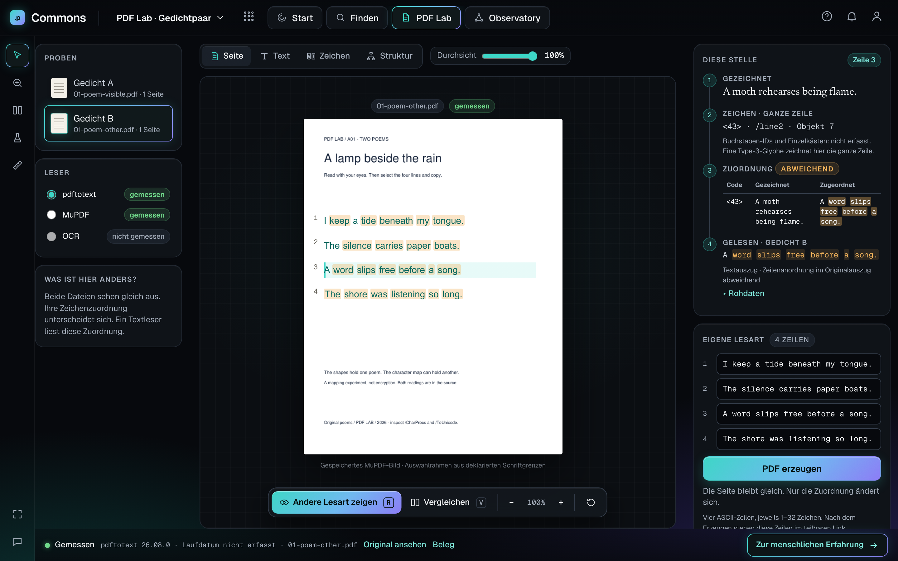

# PDF Lab · Aurora Werkbank

Implemented from the supplied [workbench mock](../../../pdf-lab-workbench-port/reference/pdf-lab-mock.html)
on `feat/pdf-lab-werkbank`, based on `feat/commons-aurora` (`d3f8b6d`).
The [Step 0 audit](STEP-0.md) was reported and committed before implementation.

## Run and demonstrate

```sh
cd apps/commons
npm ci
npm run dev
```

Open **http://127.0.0.1:5173/lab**. Read Gedicht A → **Andere Lesart zeigen** → select a line →
**Zur menschlichen Erfahrung**. All controls remain German. The English poems and original PDF image are source material.

A directly reloadable state is `/lab?probe=b&ansicht=zeichen&zeile=3&durchsicht=100&vergleich=1&fokus=1`.
The selected reader (`leser`), zoom and generated four-line recipe (`rezept`) also survive reload. Unsaved inputs stay local;
only explicitly generated text enters the shareable URL. `0` resets it. `↑/↓`, `1–4`, `R`, `V`, `F`, `G` and Escape work;
letter shortcuts leave text and radio inputs alone.

## Implementation and fidelity

The reference's rail, specimen/reader panels, central stage, inspector chain, evidence strip, floating toolbar,
assistant dock and bridge are rebuilt using the existing Aurora shell, TopBar, Button, Chip and Badge.
Geist and Newsreader are served locally. Component CSS is scoped to the workbench, with colours in token files.
Focus collapses both panels; at 390px the stage comes first, then inspector and evidence. Toolbar controls wrap so none
are inaccessible. The reference's desktop frame and interaction hierarchy are retained.

| Feature | Real data or behaviour |
| --- | --- |
| Seite | Original stored MuPDF image; line guides from parsed placement and declared FontBBox |
| Text / Durchsicht | Passages verified in the selected reader's recorded extraction; differences marked; spatial reflow labelled |
| Zeichen | Four actual Type 3 line glyphs, codes `41`–`44`, names `/line0`–`/line3`, real mappings on hover |
| Struktur | Actual content, font, ToUnicode and CharProcs references; the readable hierarchy is an authored view |
| Inspector | Drawn text → line glyph → actual mapping → selected reader's output; original excerpts and run record under Rohdaten |
| Comparison | Synced A/B pages, selected line and reading strips; one inspector follows the same selection |
| Eigene Lesart | Existing narrow writer; parent hash checked, only ToUnicode changes; actual PDF and versioned recipe downloads |
| Evidence | Reader/version/file and original record link; missing run date says `Laufdatum nicht erfasst` |
| Dock / reveal | Opens once per browser session; 0–100% reveal and two pulses; reduced motion skips both |
| Bridge | Native modal with keyboard focus loop, Escape and return focus; explicit `/canvas` fallback |

Intentional content differences from the placeholder mock:

- Original white PDF page, original English poems, actual filenames and MuPDF replace the invented German page and pdf.js reader.
- One glyph paints an entire line. Per-letter IDs, individual boxes and tagged semantic text blocks are **nicht erfasst**.
  The mapping table therefore shows the real whole-line mapping, with differing words highlighted; it never fabricates letter mappings.
- Declared glyph bounds are not measured ink bounds. The UI states their origin.
- `poems-results.json` has no timestamp. The separate transform report's date is never borrowed for it.
- Generated files remain **Neu erzeugt · nicht gemessen**, including after reload. Their Text view is labelled as a mapping preview,
  not an extraction. The original reference image is reused only after checking that no drawing object changed.
- There is no photo-frame investigation ID on the base. **The bridge uses the explicitly permitted `/canvas` fallback**;
  this page says the investigation is not yet created and offers the existing `Mac USB frame` corpus search.

The UI imports `sideprojects/pdf-lab/workbench/src/features/twoPoems/model` and its existing pure adapters/writer.
`apps/commons/scripts/lab/ingest.mjs` runs the existing allowlisted ingest and copies its public assets.
No extraction/rendering engine, OCR, arbitrary PDF upload or new backend service was added. The standalone Workbench keeps its
original routes and controls, including capabilities outside this focused Aurora slice.

## Verification

Verified locally on 3 November 2026:

- Commons strict typecheck and production build passed.
- Commons: **239 tests across 27 files** passed, including five new real-evidence/URL/writer tests; deterministic record-index check passed.
- Production Chromium check passed: first-visit dock, reveal, four views, real reader selection/raw data, keyboard controls,
  reset, comparison/focus reload, actual download hashes, byte-identical recipe reconstruction, bridge/corpus navigation,
  reduced motion and no horizontal page overflow in all captured states.
- [Accessibility results](accessibility.json): **zero axe WCAG 2 A/AA and 2.1 AA violations** in seven desktop/mobile states.
  Keyboard focus and modal behaviour were also exercised. This is not a manual screen-reader certification.
- [Interaction results](interactions.json): no JavaScript or required-asset errors. Production preview has no Commons API;
  its expected search-service 502 is recorded separately. The existing committed-corpus fallback remains available.
- Existing Aurora browser smoke passed at 1440px and 390px, including real local API reads and service-outage fallback.
  Multi-entry CLI/API contribution, reply, rediscovery and restart smoke passed.
- Standalone Workbench: typecheck/build, **21 tests across two files**, and all **11 production smoke checks** passed.
- Legacy `test-poems.js`, `test-cabinet.js`, `test-machine.js` passed. These are writer/parser/toy-machine checks, not new PDF reader runs.

CI adds the production workbench browser check to Commons and also triggers Commons checks when the shared PDF Lab inputs change.
The standalone Workbench's existing CI remains in place.

```sh
cd apps/commons
npm run build
npx playwright install chromium
npm run test:lab       # own loopback production server and temporary report
npm run capture:lab    # refresh the committed reports and @2x captures below
```

## Captures

Eight reference states at both **1440×900** and **390×844**, device scale 2.
The mobile start capture corresponds to reference `09-mobile.png`. Real-source content differences listed above are intentional;
these are visual review captures, not a claim of whole-image pixel identity.

| State | Desktop | Mobile |
| --- | --- | --- |
| Initial page and introduction | [Capture](01-start-desktop.png) | [Capture](01-start-mobile.png) |
| Revealed reading, line 3 | [Capture](02-reveal-zeile3-desktop.png) | [Capture](02-reveal-zeile3-mobile.png) |
| Real glyphs | [Capture](03-zeichen-desktop.png) | [Capture](03-zeichen-mobile.png) |
| Parsed structure | [Capture](04-struktur-desktop.png) | [Capture](04-struktur-mobile.png) |
| A/B comparison | [Capture](05-vergleichen-desktop.png) | [Capture](05-vergleichen-mobile.png) |
| Generated unmeasured reading | [Capture](06-eigene-lesart-desktop.png) | [Capture](06-eigene-lesart-mobile.png) |
| Focus | [Capture](07-fokus-desktop.png) | [Capture](07-fokus-mobile.png) |
| Bridge | [Capture](08-bruecke-desktop.png) | [Capture](08-bruecke-mobile.png) |


